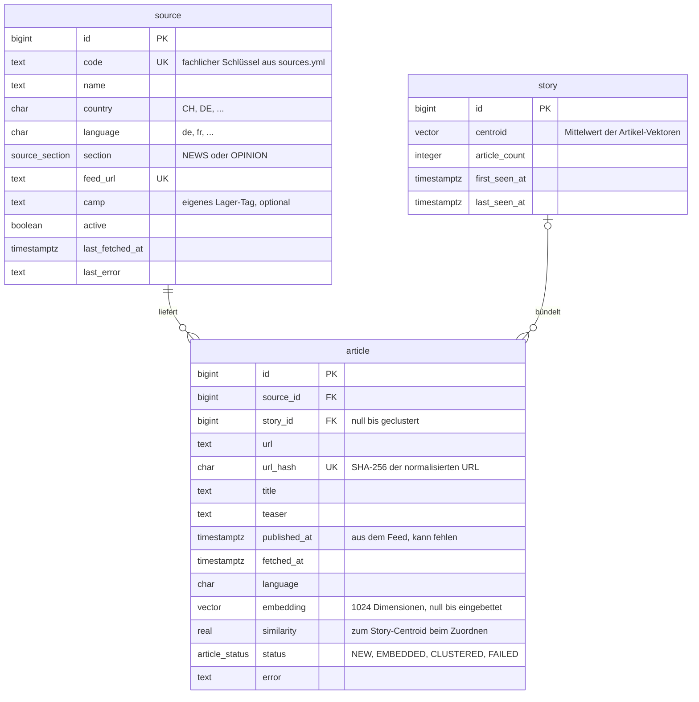
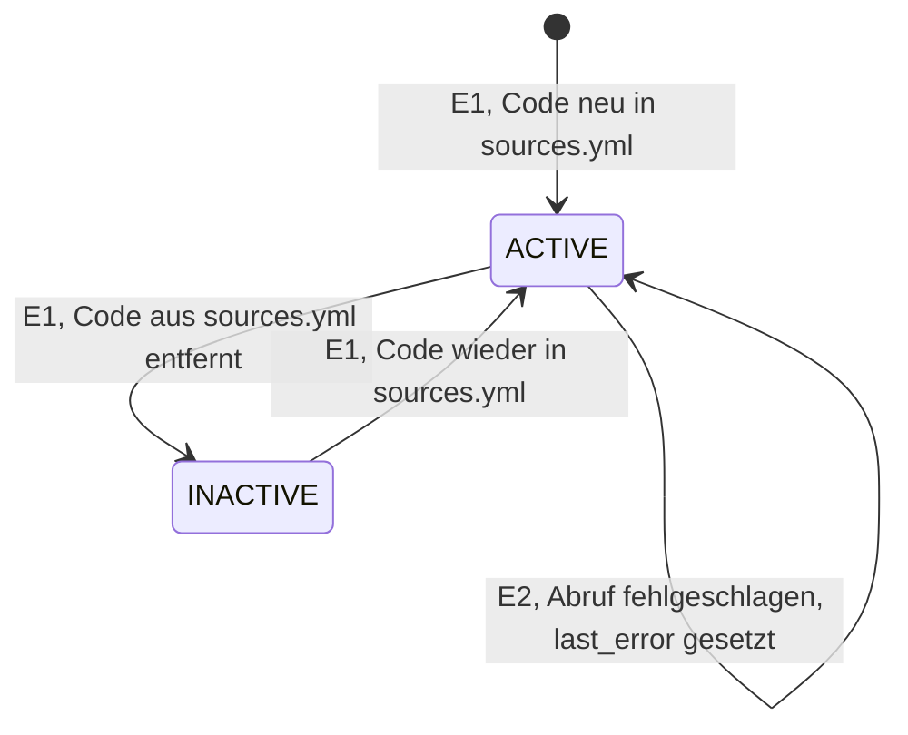
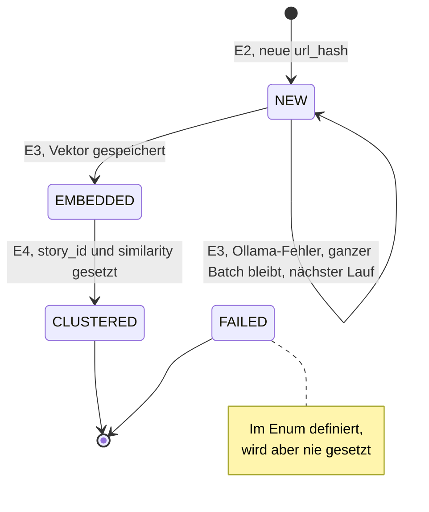
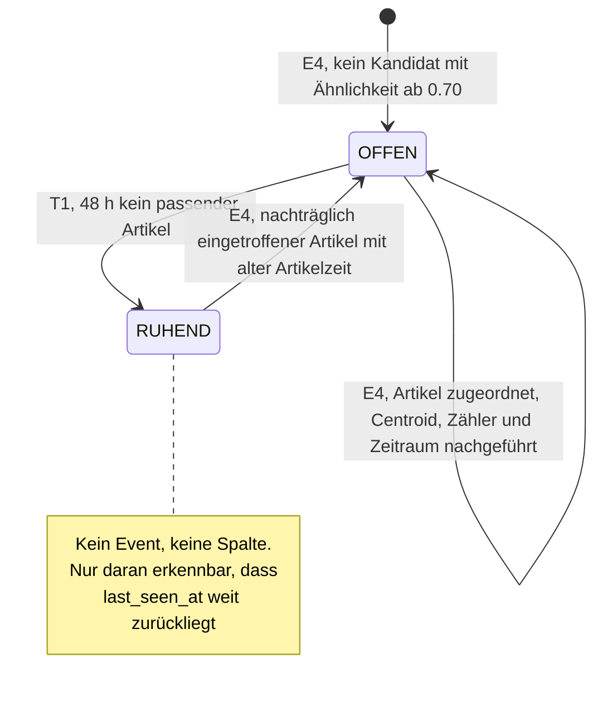
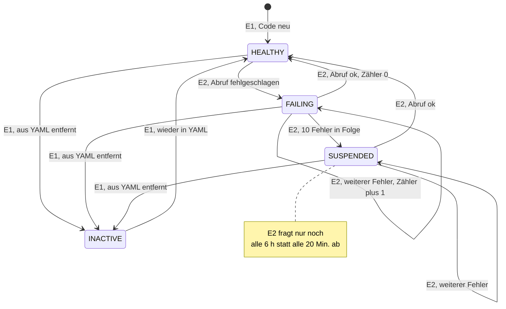
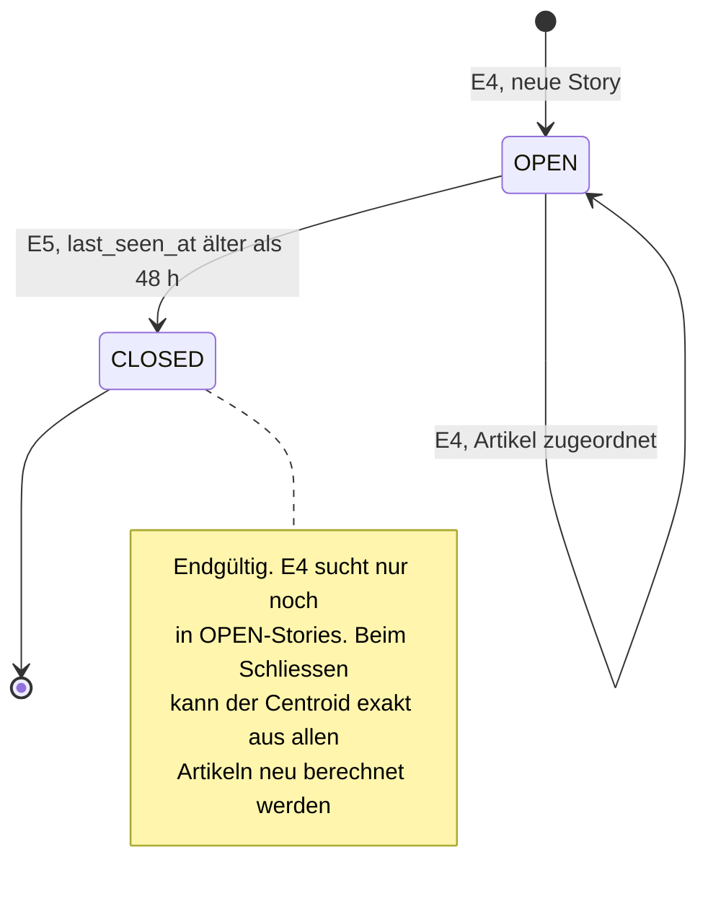

# Datenmodell und Entity-Lebenszyklen

Stand: 24.10.2026. Dieses Dokument beschreibt

- **Ist:** was der Code heute tatsächlich tut, inklusive impliziter Übergänge und Lücken
- **Soll:** einen **Vorschlag** für saubere Lebenszyklen, zur Diskussion. Nichts davon ist umgesetzt.

---

## 1. Datenmodell (Ist)

**Artikelzeit:** Überall, wo der Lebenszyklus mit Zeit rechnet, gilt
`coalesce(published_at, fetched_at)`. Fehlt das Publikationsdatum, zählt der Abrufzeitpunkt.

---

## 2. Event-Katalog (Ist)

Alle Zustandsänderungen entstehen durch diese Events. Es gibt keine Benutzeraktionen
und keine externen Trigger.

| # | Event | Auslöser | Takt | Betroffene Entität |
|---|---|---|---|---|
| E1 | `SourceSync.run` | App-Start | einmal | `source` |
| E2 | `IngestService.ingestAll` | Scheduler | 20 Min. nach Ende des letzten Laufs, erster Lauf 10 s nach Start | `source`, `article` |
| E3 | `EmbeddingService.embedPending` | Scheduler | 1 Min. nach Ende, erster Lauf nach 20 s | `article` |
| E4 | `ClusteringService.clusterPending` | Scheduler | 1 Min. nach Ende, erster Lauf nach 30 s | `article`, `story` |
| T1 | Zeitablauf 48 h | keiner, rein implizit | – | `story` |

Zwei Eigenschaften, die für die Lebenszyklen wichtig sind:

- **`fixedDelay`:** Das Intervall zählt ab dem *Ende* des letzten Laufs. Ein Job überholt sich nie selbst.
- **Ein einziger Scheduler-Thread:** Spring Boot hat standardmässig einen Pool der Grösse 1.
  E2, E3 und E4 laufen deshalb **nie gleichzeitig**, sondern nacheinander. Das schliesst
  Wettläufe zwischen den Jobs aus. Die Kehrseite: Ein langsamer Ingest (11 Feeds mit je bis
  zu 20 s Timeout) verzögert Embedding und Clustering.

---

## 3. Lebenszyklen (Ist)

### 3.1 `source`

Explizit modelliert ist nur `active`. Gesundheit (`last_error`) wird protokolliert, hat aber
keine Konsequenz: Ein dauerhaft kaputter Feed wird weiterhin alle 20 Minuten abgerufen.

**Lücken:**
- Ein Code-Wechsel bei gleicher `feed_url` verletzt den Unique-Constraint und lässt E1 und damit den Start scheitern.
- Es gibt keine Unterscheidung zwischen «einmal ausgefallen» und «seit Tagen tot».

### 3.2 `article`

Der einzige explizite Lebenszyklus. Er ist die Pipeline.

| Übergang | Event | Was sich ändert |
|---|---|---|
| → NEW | E2 | Zeile angelegt. Bekannte URL: kein Übergang (`on conflict do nothing`) |
| NEW → EMBEDDED | E3 | `embedding` |
| NEW → NEW | E3 | nichts, Fehler wird nur geloggt |
| EMBEDDED → CLUSTERED | E4 | `story_id`, `similarity` |

**Lücken:**
- **Giftpille in E3:** Scheitert ein Batch wegen eines bestimmten Artikels, scheitert er bei jedem Lauf erneut. Die ganze Pipeline steht.
- **Giftpille in E4:** Eine Exception bricht die Schleife ab. Derselbe Artikel ist beim nächsten Lauf wieder der erste.
- `CLUSTERED` ist endgültig: Es gibt keinen Weg, einen Artikel neu zu clustern (etwa nach Änderung des Schwellwerts), ausser per SQL.

### 3.3 `story`

Keine Statusspalte. Die Zustände ergeben sich nur aus den Zeitstempeln und sind **abgeleitet**.

**Warum «ruhend» und nicht «geschlossen»:** Kandidat ist jede Story, deren Zeitraum das
Fenster ±48 h um die *Artikelzeit* überlappt, nicht um *jetzt*. Ein Artikel, der heute mit
einem Publikationsdatum von vor drei Tagen eintrifft, kann eine scheinbar abgeschlossene Story
wiederbeleben. Fachlich ist das sogar richtig, macht den Zustand einer Story aber nie endgültig.

**Lücken:**
- Nachgelagerte Auswertungen (Scoring, Bias-Statistik) wissen nicht, wann eine Story «fertig» ist und sich nicht mehr ändert.
- Der Centroid kann über die Zeit wandern (Drift) und verwandte, aber andere Ereignisse einsammeln.

---

## 4. Soll-Vorschlag (zur Diskussion)

Leitidee: **Jeder Zustand ist explizit gespeichert, und jeder Übergang hat genau ein Event.**
Implizite Zustände werden zu Spalten, Endlos-Schleifen zu begrenzten Wiederholungen.

### 4.1 Zusätzliche Events

| # | Event | Takt | Zweck |
|---|---|---|---|
| E5 | `StoryCloser.closeStale` | stündlich | `OPEN → CLOSED` für Stories ohne Aktivität |
| E6 | Requeue | manuell (SQL oder Admin-Endpoint) | `FAILED → NEW`, etwa nach Modellwechsel |

E2 bekommt einen **Backoff** für kranke Quellen (siehe 4.2).

### 4.2 `source`

Neue Spalten: `health` (Enum), `consecutive_failures` (int).

`INACTIVE` bleibt eine bewusste, manuelle Entscheidung (YAML). `SUSPENDED` ist automatisch
und heilt sich selbst, sobald der Feed wieder antwortet.

### 4.3 `article`

Neue Spalten: `attempts` (int), `last_attempt_at` (timestamptz). `error` existiert schon.

```mermaid
stateDiagram-v2
    [*] --> NEW : E2
    NEW --> NEW : E3, Ollama nicht erreichbar, zählt nicht als Versuch
    NEW --> EMBEDDED : E3, ok
    NEW --> FAILED : E3, artikelspezifischer Fehler, 3 Versuche erreicht
    EMBEDDED --> CLUSTERED : E4, ok
    EMBEDDED --> FAILED : E4, Exception bei diesem Artikel
    FAILED --> NEW : E6, manuell neu einreihen
    CLUSTERED --> SCORED : Scoring-Service, später
    SCORED --> [*]
```

Die wichtige Unterscheidung in E3:

- **Infrastrukturfehler** (Ollama down, Timeout): kein Versuch zählt, der Artikel bleibt `NEW`. Das Problem liegt nicht beim Artikel.
- **Artikelfehler** (HTTP 4xx): Der Batch wird in Einzel-Requests aufgeteilt, um den schuldigen Artikel zu finden. Nur dieser wird gezählt und nach 3 Versuchen `FAILED`. Die anderen laufen weiter.

In E4 bekommt jeder Artikel ein eigenes `try/catch`. Ein Fehler setzt `FAILED`, statt die Schleife abzubrechen.

`SCORED` gehört nicht zu diesem Service. Das Enum muss den Zustand aber kennen, damit der
Quarkus-Service ihn setzen kann.

### 4.4 `story`

Neue Spalten: `status` (`OPEN`, `CLOSED`), `closed_at` (timestamptz).

**Gewinn:**
- Nachgelagerte Auswertungen können sich auf `CLOSED` verlassen: Diese Stories ändern sich nie mehr.
- Die Kandidatenmenge für E4 bleibt klein, auch nach Monaten.
- «Wann ist eine Story fertig?» wird beantwortbar, statt aus Zeitstempeln geraten.

**Preis:** Ein Artikel, der nach dem Schliessen mit altem Datum eintrifft, eröffnet eine neue
Story, statt sich der alten anzuschliessen.

---

## 5. Offene Entscheidungen

| Frage | Vorschlag | Alternative |
|---|---|---|
| Wird eine Story endgültig geschlossen? | ja, nach 48 h ohne Aktivität (E5) | wie heute, nur implizit ruhend |
| Spät eintreffende Artikel bei geschlossener Story | neue Story | geschlossene Story wieder öffnen |
| Wie oft wird ein fehlerhafter Artikel wiederholt? | 3 Versuche | 1 (sofort `FAILED`) oder 5 |
| Ab wann ist eine Quelle `SUSPENDED`? | 10 Fehler in Folge (etwa 3 h) | 24 h ohne Erfolg, zeitbasiert |
| Abfrageintervall im Zustand `SUSPENDED` | 6 h | 1 h oder gar nicht, nur manuell |
| Neu-Clustern nach Schwellwert-Änderung | manuell per SQL | eigenes Event mit Zurücksetzen auf `EMBEDDED` |
| Eigener Thread-Pool für die Jobs? | nein, sequenziell ist einfacher und wettlauffrei | Pool, damit ein langsamer Ingest nicht bremst |
